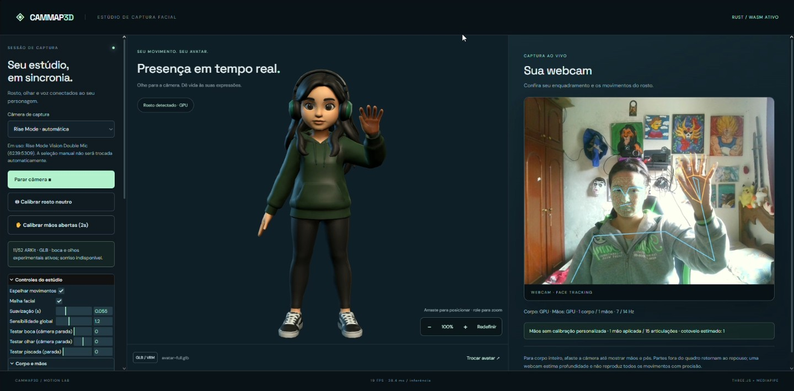
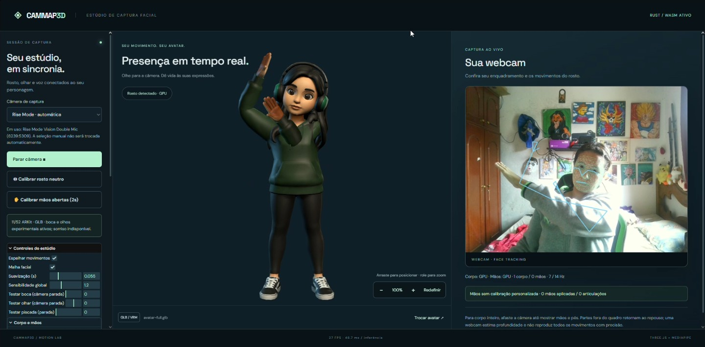
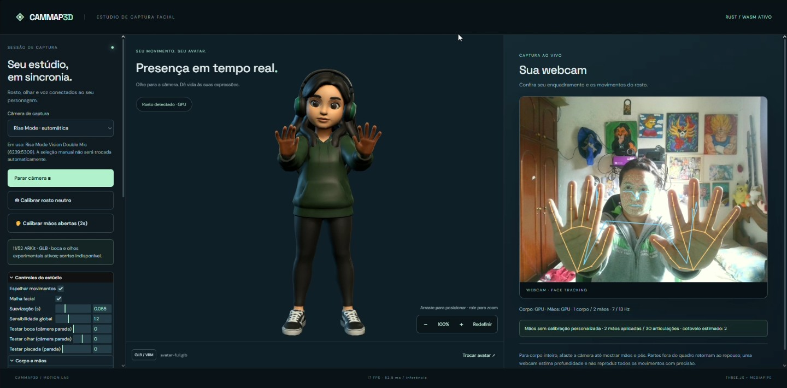

# CamMap3D

Estúdio web local de captura de rosto, corpo e mãos: Vite + TypeScript, Three.js, MediaPipe Face/Pose/Hand Landmarker e filtro facial em Rust/WebAssembly, sem framework de UI.



## Demonstração

Capturas da demonstração gravada no Opera, com a webcam Rise Mode e o avatar preparado para este projeto. As imagens mostram uma versão em desenvolvimento; a fidelidade depende do enquadramento, iluminação e rig do modelo.

### Rastreamento de corpo e braços



### Mãos e dedos em tempo real



O aplicativo permite trocar avatares GLB/VRM, calibrar rosto e mãos, ajustar zoom e posição do personagem e usar fundo transparente para composição no OBS. A captura é processada localmente no navegador.

## Executar

Requer Node.js 22.12+ (ou 20.19+). Em um terminal nesta pasta:

```sh
npm install
npm run dev
```

Abra o endereço exibido pelo Vite (normalmente http://127.0.0.1:5173), clique em **Iniciar câmera** e autorize o acesso. Os assets do MediaPipe e fontes exigem internet na primeira carga. Para distribuir: `npm run build`; para testar o build: `npm run preview`. `npm test` requer Node 22.6+ e verifica filtros, calibração e equivalência do WASM.

## Seu modelo Tripo

O modelo atual usa a versão com rig Mixamo fornecida pelo usuário. O arquivo recebido é preservado em `public/models/avatar.glb` e `public/models/avatar-rig-original.glb`. O app carrega a cópia preparada em **`public/models/avatar-full.glb`**. A versão anterior, somente com boca, permanece em `avatar-face.glb`.

Inspeção da versão com rig: 65 ossos, incluindo cabeça e pescoço, mas sem mandíbula, ossos dos olhos ou morph targets faciais. O export Tripo também omitiu todas as transformações dos nós, embora contivesse inverse bind matrices. Isso causava a deformação do avatar mesmo com câmera desligada. `scripts/repair-avatar-bind.mjs` reconstrói uma cópia específica desse export e corrige a convenção de eixos das matrizes. O original não é modificado. Esse reparo não é um conversor genérico para outros modelos.

Foi preparada a expressão **`jawOpen`**: abertura real na malha dos lábios e superfície oral escura rebaixada. A versão `avatar-full.glb` também inclui oito canais `eyeLook*`, duas piscadas e pálpebras procedurais. São **11/52 canais ARKit**. O olhar usa deformação localizada, sem globos oculares separados. A pele das pálpebras pode diferir da textura original. **Sorriso, língua e dentes ainda não foram criados.** A aparência é experimental e pode precisar de refinamento artístico, principalmente nos lábios, pálpebras e em ângulos laterais.

Com câmera parada, use os controles **Testar boca**, **Testar olhar** e **Testar piscada** para inspecionar. Com câmera ativa, esses valores vêm do rastreamento. Faça a calibração de rosto neutro e ajuste os ganhos se necessário.

O Blender 4.5.9 LTS portátil está em `tools/blender/blender-4.5.9-windows-x64/`, sem instalação global. O arquivo editável atual é `public/models/avatar-full.blend`, e `avatar-face.blend` preserva a etapa de boca. Para reproduzir:

```powershell
node scripts/repair-avatar-bind.mjs
$env:BLENDER_USER_RESOURCES = "$PWD/tools/blender/user"
& ./tools/blender/blender-4.5.9-windows-x64/blender.exe --background --factory-startup --python scripts/prepare-face.py
& ./tools/blender/blender-4.5.9-windows-x64/blender.exe --background --factory-startup --python scripts/prepare-eyes.py
```

Os scripts usam coordenadas aferidas desse rosto e recusam parte das entradas incompatíveis; não devem ser usados como autorig universal. O script Python preserva as texturas, abre a junção dos lábios, cria a Shape Key e exporta skin + morph. Renders fechada/meia/aberta e relatório ficam em `artifacts/`. `scripts/inspect-face.py` produz o close-up de inspeção inicial.

## Trocar o modelo

**Braço para a câmera:** a correção pela imagem preserva a componente de profundidade estimada pelo Pose. A proporção do tamanho aparente da palma com a largura dos ombros fornece uma pista adicional de aproximação; quando forte, orienta o braço por cinemática inversa em direção à câmera, reduzindo o deslocamento lateral causado pela perspectiva. É uma heurística monocular, sensível à orientação da palma, proporções e erros de detecção, e não mede distância real.

**Enquadramento próximo:** quando o cotovelo não é confiável, mas os dois ombros e uma mão são detectados, o app estima a dobra do braço por cinemática inversa de dois ossos, usando a largura dos ombros como escala. Mantém os comprimentos do rig e indica **cotovelo estimado** no painel. É uma aproximação da articulação oculta, não uma medição; sem ombros ou mão confiáveis, retorna suavemente ao repouso. A estimativa exige corpo e mãos ativos.

Em **Corpo e mãos**, **Braços: fidelidade ao vídeo** corrige a direção no plano da imagem (padrão 80%), preservando a profundidade estimada. **Alcance para a câmera** regula a pista de aproximação da palma: 0 desativa essa pista, 1 é o padrão. Calibre o rosto neutro separadamente e use **Calibrar mãos abertas (2s)** com palmas visíveis e dedos esticados; um punho fechado não é a pose de calibração das mãos.

- Substitua `public/models/avatar-full.glb`, ou altere `AVATAR_URL` em `src/config.ts` para o modelo desejado, por exemplo `/models/avatar.vrm`.
- Arraste um `.glb` ou `.vrm` para a página ou use **Trocar avatar** a qualquer momento, inclusive com a câmera ligada. O nome do arquivo aparece abaixo do personagem. Arquivos locais não são enviados a servidor. Cada avatar precisa dos ossos e expressões correspondentes aos movimentos desejados.
- Para aproximar ou afastar o personagem, use a roda do mouse sobre a área 3D ou os botões **+** e **−**. Com OrbitControls desligado, clique e arraste nessa área para posicionar o avatar para baixo, para cima ou para os lados (também por toque). **Redefinir** centraliza novamente e retorna a 100%. O zoom vai de 50% a 300%; zoom e enquadramento são preservados ao redimensionar a janela. Os botões ficam ocultos no fundo transparente para OBS.
- Prefira GLB autocontido, com texturas incorporadas. Dependências externas de um arquivo arrastado não podem ser resolvidas automaticamente.
- O enquadramento normaliza a altura para 2,8 unidades. O modelo deve estar em pé, eixo Y para cima e olhando para +Z. GLBs com outra convenção precisam ser corrigidos na exportação. VRM 0 é ajustado pelo three-vrm.
- O loader suporta glTF comum e VRM; extensões que exigem decodificadores adicionais (por exemplo Draco/KTX2) não estão configuradas.

## Requisitos e mapeamento facial

Os nomes ARKit ficam em `ARKIT`, em `src/config.ts`. Os morphs devem ter esses nomes, sem prefixos; a correspondência ignora maiúsculas/minúsculas e separadores. Todos os meshes são percorridos e seus dicionários são listados no console, junto dos canais encontrados/ausentes. Um canal pode afetar vários meshes (face, dentes etc.).

MediaPipe entrega 52 categorias incluindo `_neutral`, mas não fornece `tongueOut`: a lista ARKit tem 52 incluindo língua. `_neutral` é ignorado e `tongueOut` permanece zero. Não há captura de língua neste modelo de rastreamento.

VRM: `aa` recebe abertura com fechamento, `ih` alongamento, `ou` bico, `ee` sorriso, `oh` funil; vogais são normalizadas para reduzir soma excessiva. `happy`, `angry`, `sad`, `surprised`, `blinkLeft/Right` (ou `blink`) e olhar também são aproximados. Isso é retargeting heurístico de expressões, não classificação de fonemas nem interpretação de emoções. O conjunto disponível depende do VRM; o console o lista.

Ossos GLB reconhecidos: `head`, `neck`, `jaw`/`mandible`, `leftEye`/`eyeLeft`, `rightEye`/`eyeRight`, incluindo prefixo Mixamo. Para rigs diferentes, ajuste os aliases em `src/avatar.ts`. Descanso dos ossos é preservado; rotação é dividida entre pescoço (40%) e cabeça (60%). Sem esses ossos, mantém o personagem estável e avisa que falta rig; o movimento do modelo inteiro é opcional e começa desligado. Sem `jawOpen` e sem vogal VRM `aa`, tenta o osso jaw. Sem morphs de boca e sem jaw, avisa na interface. O eixo de abertura padrão de jaw é X positivo; alguns rigs exigem ajuste.

## Uso e qualidade

1. Enquadre o rosto, olhe de frente e clique em **Calibrar rosto neutro**. Mantenha expressão relaxada por dois segundos. A perda do rosto cancela a amostragem e preserva a base anterior.
2. Ajuste sensibilidade global e ganhos individuais, principalmente `jawOpen` e `mouthSmileLeft/Right`.
3. Suavização é uma constante de tempo em segundos: valores menores respondem mais rápido, maiores reduzem tremida. O filtro exponencial usa o tempo decorrido, independentemente do FPS de renderização.
4. **Espelhar movimentos** controla rotação, deslocamento, lado dos morphs e preview; desative para comparar. Os lados anatômicos do MediaPipe são os da pessoa.
5. Sem rosto ou sem frames por 300 ms, retorna suavemente ao neutro. **Voz sem rosto** pede microfone e usa RMS do áudio somente quando não há rastreamento; não reconhece palavras nem fonemas. O áudio não é reproduzido nem enviado.
6. **OrbitControls** começa desativado. Ative para inspecionar enquadramento e orientação.

Use luz frontal difusa, evite janela forte atrás, mantenha olhos visíveis e câmera próxima da altura dos olhos. Óculos com reflexo, mãos sobre a boca e ângulos extremos degradam a captura.

## OBS e transparência

Ative **Fundo transparente** para alpha zero no canvas e ocultar sobreposições da área 3D. Para uma Browser Source do OBS apontada ao servidor local, use CSS customizado para exibir somente o canvas:

```css
html, body, #app, main, #stage { background: transparent !important; margin: 0; }
header, aside, footer, #camera-panel, #stage > :not(canvas) { display: none !important; }
main { display: block !important; }
#stage { width: 100vw; height: 100vh; min-height: 0 !important; }
```

O estado não é compartilhado entre abas/Browser Sources. A instância do OBS precisa conseguir iniciar a câmera; permissões e suporte a câmera/GPU variam conforme a versão do OBS. A captura comum de uma janela já composta não preserva automaticamente o alpha.

## Rust / WebAssembly

O binário compilado `public/wasm/cammap_filters.wasm` acompanha o projeto; Rust **não é necessário** para `npm install && npm run dev`. A interface confirma `RUST / WASM ATIVO` após carregá-lo. Se estiver ausente/incompatível, a aplicação usa o mesmo filtro TypeScript.

O módulo recebe 58 floats (52 coeficientes e 6 componentes de pose) em memória linear fixa e processa um lote por frame. Ele filtra valores assinados de pose também; clamp de blendshapes ocorre na entrada e limites de pose na aplicação. Não usa wasm-bindgen, não faz alocação por coeficiente e não altera MediaPipe: inferência já usa o runtime WASM/GPU da biblioteca.

Para recompilar com Rust instalado no sistema:

```sh
rustup target add wasm32-unknown-unknown
npm run build:rust
npm test
```

Neste ambiente foi instalada uma toolchain **isolada**, ignorada pelo Git, em `.cargo` e `.rustup`. Para reutilizá-la no PowerShell:

```powershell
$env:CARGO_HOME = "$PWD/.cargo"
$env:RUSTUP_HOME = "$PWD/.rustup"
$env:Path = "$PWD/.cargo/bin;C:/;" + $env:Path
npm run build:rust
```

**Avaliação de desempenho:** o lote de 58 canais é pequeno; a chamada WASM e cópias podem custar mais que a aritmética em JS. Não se declara aceleração sem benchmark na máquina-alvo. O provável custo dominante é `detectForVideo`, síncrono no thread principal, seguido de renderização/texturas. O app detecta somente frames novos; renderização segue requestAnimationFrame. FPS e tempo da última inferência são exibidos. Em modelos pesados, reduza resolução da câmera, geometria, texturas e pixel ratio. Para produção com orçamento rígido de latência, uma evolução é mover inferência para Worker com transferência de frames e controle de backpressure, medindo suporte e custos; isso não está implementado aqui.

## Avaliação técnica por aplicação

Esta é uma avaliação de adequação por famílias de projeto, não uma certificação universal. Não há números de precisão ou FPS de webcam medidos neste ambiente.

| Aplicação | Adequação desta base | Trabalho adicional necessário |
| --- | --- | --- |
| VTuber, avatar, streaming, apresentações | Alvo principal; um rosto e rig compatível | Validar câmera real, calibração, eixos do rig e integração OBS |
| Jogos e interação em navegador | Expressões e pose como entrada local | Medir latência p50/p95, quedas e uso térmico; mapear ações e permitir entrada alternativa |
| Ensino, protótipos e instalações | Boa base de demonstração | Modo offline dos assets, reinício automático, acessibilidade e testes no hardware final |
| Cinema e mocap profissional | Protótipo de rosto, corpo e mãos | Gravação de coeficientes, timecode, solver/rig específico e validação artística; não substitui captura profissional |
| Mobile e XR | Depende de WebGL e orçamento térmico | Ensaios em dispositivos reais, redução de carga e tratamento de suspensão/permissões |
| Telepresença e reuniões | Animação local pronta | Transporte remoto, sincronização, autenticação e segurança não implementados |
| Saúde, diagnóstico, avaliação psicológica | Não validado para isso | Validação clínica específica; coeficientes faciais não medem condição clínica ou estado emocional |
| Login e controle de acesso privado | Não verifica identidade | Sistema separado de verificação 1:1, cadastro autorizado, proteção de templates e detecção de apresentação/liveness avaliada |
| Câmeras de segurança privadas | Não integra RTSP/NVR nem identifica pessoas | Gateway autenticado, ingestão de vídeo, análise de finalidade, qualidade e validação em campo |
| Câmeras públicas e múltiplos locais | Não é um sistema operacional de vigilância | Arquitetura, avaliação de impacto e governança específicas; testes independentes antes de qualquer decisão sobre pessoas |

### Reconhecimento facial e câmeras públicas/privadas

FaceLandmarker detecta geometria, pose e coeficientes de expressão; **não gera identidade, embeddings de reconhecimento, busca em galeria nem prova de vida**. Comparar esses 52 coeficientes não produz um identificador confiável. Piscadas e abertura de boca isoladas não constituem proteção contra fraude. O avatar e seu rig não acrescentam identificação de pessoas.

O navegador recebe webcam por getUserMedia; não abre RTSP diretamente. Uma instalação autorizada com câmeras IP precisaria de um gateway para um formato de vídeo suportado, credenciais protegidas no servidor, TLS e controle de acesso. O app atual não contém gateway, cadastro, banco de rostos, gravação, identificação ou alertas.

Identificação 1:N em vídeo é um problema distinto de verificação 1:1. Uma avaliação séria deve medir falsos positivos/falsos negativos, FPIR/FNIR para identificação, limiares, tamanho da galeria, taxa de desconhecidos, rostos por frame, oclusão, compressão, distância, iluminação, qualidade noturna e diferenças entre grupos. O NIST documenta efeitos da qualidade de vídeo e diferenças de erro entre algoritmos e populações; esses resultados não podem ser transferidos como uma garantia de precisão deste app. Veja [avaliação de faces em vídeo do NIST](https://www.nist.gov/news-events/news/2017/04/identifying-faces-video-images-major-challenge-nist-report-shows) e [efeitos demográficos no FRTE](https://pages.nist.gov/frvt/html/frvt_demographics.html).

Para qualquer cenário de reconhecimento público ou privado, a análise precisa incluir finalidade e base legal aplicáveis, minimização, retenção e descarte, proteção de templates e credenciais, rastreabilidade de acesso, transparência e contestação/revisão humana. No Brasil, a ANPD trata biometria vinculada à identificação como dado pessoal sensível; consulte a [Nota Técnica 54/2025 da ANPD](https://www.gov.br/anpd/pt-br/assuntos/noticias/NotaTcnica54.2025MTP2025.pdf) e análise jurídica específica antes da implantação. Esta documentação não autoriza coleta em câmeras de terceiros nem garante conformidade regulatória. Nenhum alerta ou decisão de segurança baseado em identidade foi implementado neste projeto.

### Critérios para validar uma implantação

Defina antes do piloto o hardware, rig, número de streams, FPS mínimo, atraso aceitável e condições de iluminação. Meça p50/p95 do tempo de inferência e captura→renderização, memória, uso de CPU/GPU, aquecimento e estabilidade prolongada. Verifique perda de rosto, desconexão, permissões negadas, fallback CPU e recuperação. Para biometria, use protocolo específico com dados autorizados e avalie erros por cenário; os testes unitários deste repositório não cobrem reconhecimento de identidade.

## Solução de problemas

- **npm não encontra node no Windows:** adicione a pasta do Node ao PATH e reabra o terminal. Neste computador `node.exe` e `npm.cmd` estão em `C:\`; pode ser necessário `$env:Path = 'C:/;' + $env:Path`.
- **Câmera bloqueada:** use localhost/HTTPS, libere a permissão no navegador e confira se outro aplicativo ocupa o dispositivo. A captura só inicia por clique e nunca pede microfone sem ativar o toggle de voz.
- **Barras coloridas ou câmera errada:** use o seletor **Câmera de captura**, acima de Iniciar câmera, para escolher a webcam física. Após conceder permissão, a lista mostra os nomes e o dispositivo ativo. A escolha manual é preservada entre recargas e usa o identificador exato do dispositivo. Atualizações da lista não substituem sua escolha pela câmera anterior. Se a câmera escolhida falhar ou o navegador retornar outro dispositivo, a captura para e mostra o erro, sem ativar outra câmera. Rise Mode · automática procura a Rise Mode pelo nome e não abre outra câmera quando ela está ausente. A placa de captura identificada pelo rótulo 534d:2109 é bloqueada somente no projeto, sem alteração no Windows; outras webcams podem ser selecionadas manualmente. Em um navegador sem permissão prévia, autorize a câmera nas configurações do site do Opera para disponibilizar os nomes dos dispositivos. A troca de câmera com sessão ativa mantém o rastreador carregado.
- **Falha ao carregar MediaPipe:** confira internet, proxy/firewall e acesso às constantes de CDN em `src/config.ts`. O WASM usa a mesma versão do pacote npm. GPU indisponível ao inicializar tenta CPU e indica o backend.
- **Falha de inferência durante a sessão:** a câmera é encerrada; clique novamente em iniciar. A troca para CPU é implementada na inicialização, não como recuperação automática de perda de contexto GPU.
- **Boca imóvel:** abra o console e confira os morphs. A cópia preparada `avatar-face.glb` tem `jawOpen`; a versão original com rig não tem morphs faciais. Confirme qual arquivo está sendo carregado e teste o slider com a câmera parada. Renomear arquivo não cria canais.
- **Movimento invertido:** teste espelho e confira orientação do GLB, eixos dos ossos e nomes anatômicos. Rigs heterogêneos podem exigir retargeting específico em `avatar.ts`.
- **Avatar some ou demora:** use GLB com texturas incorporadas, confira tamanho e extensões; tente um export sem Draco/KTX2. Drop inválido preserva o avatar anterior.
- **Muita tremida ou atraso:** ajuste luz e suavização; uma câmera com pouca luz pode fornecer menos de 30 FPS mesmo com frameRate ideal de 30.

## Organização e referências

`src/main.ts`: loop e composição; `tracker.ts`: câmera, MediaPipe e microfone; `avatar.ts`: carregamento, inspeção e retargeting; `filters.ts`: calibração, filtro adaptativo One Euro e filtros faciais; `motion.ts`: retargeting de corpo, palma e dedos e calibração manual; `motion-quality.ts`: associação global das mãos e cinemática inversa; `ui.ts`: painel; `config.ts`: URLs e canais; `rust/src/lib.rs`: núcleo WASM; `tests/filters.test.ts` e `tests/motion.test.ts`: verificações numéricas e de movimento.

Documentação de referência: [MediaPipe FaceLandmarker Web](https://developers.google.com/edge/mediapipe/solutions/vision/face_landmarker/web_js), [VRMLoaderPlugin](https://pixiv.github.io/three-vrm/docs/classes/three-vrm.VRMLoaderPlugin.html), [VRMExpressionManager](https://pixiv.github.io/three-vrm/docs/classes/three-vrm.VRMExpressionManager.html).

O processamento de câmera/áudio permanece no navegador; assets/fontes são baixados de terceiros. Não há backend nem upload de frames. Este projeto não possui telemetria de captura.

## Verificação realizada

- `npm install`: instalação concluída, auditoria sem vulnerabilidades reportadas.
- `npm run build`: TypeScript e produção aprovados; Vite informa um aviso de tamanho do bundle (Three.js/VRM/MediaPipe), sem erro de compilação.
- `npm run build:rust`: binário WASM de release compilado.
- `npm test`: 23 testes aprovados, incluindo paridade Rust/TypeScript, One Euro, associação das mãos, cinemática inversa, braço cortado, alcance para a câmera, perda breve de detecção, pose, espelho, deslocamento, giro de palma, articulações independentes e calibração.
- Servidor Vite iniciado e resposta HTTP 200 verificada.
- Chrome headless com câmera sintética: modelo preparado renderizado, WASM ativo, MediaPipe inicializado, preview e caminho de ausência de rosto operantes, sem exceções JavaScript. A pose neutra mantém altura 2,8 e erro abaixo de 1e-4 entre carregamento/aplicação neutra; `jawOpen` move a boca; rotação da cabeça não move a parte inferior do corpo. O teste também verifica seleção de câmera e layout desktop/mobile. Captura local em `artifacts/studio.png` (ignorada pelo Git).

Para repetir o smoke test, inicie `npm run dev` em um terminal e execute `node scripts/smoke.mjs` em outro. Requer Chrome instalado; `CHROME_PATH` permite escolher seu executável. O teste usa mídia sintética, nunca sua webcam real. O avatar preparado tem rig e 11 canais faciais. O fallback CPU em hardware sem GPU, outros rigs VRM e a fidelidade fina na webcam do usuário ainda precisam de validação interativa.

`scripts/review-video.mjs "caminho-do-video.mp4"` extrai uma folha de quadros localmente. `--analyze` reexecuta Pose/Hands sobre o recorte da webcam; `--retarget` reproduz os pontos salvos no rig e gera comparação visual. Esse script foi preparado para a gravação de tela 1920×1032 deste projeto, com recorte fixo em (1282,338,592,444); para outro layout, ajuste o recorte. A revisão usou 288 instantes de uma gravação de 72 segundos. Como a gravação já contém landmarks desenhados, a reinferência não é verdade de referência nem mede precisão percentual. Os vídeos, imagens e pontos derivados permanecem locais, em `artifacts/`, ignorados pelo Git.

O teste de navegador confirmou inicialização GPU de Face/Pose/Hands e movimento do rig real. Uma fotografia de mão da [suíte oficial MediaPipe](https://github.com/google-ai-edge/mediapipe/blob/master/mediapipe/tasks/python/test/vision/hand_landmarker_test.py), quando disponível em `artifacts/hand-reference-plain.jpg`, também é inferida pelo modelo real: seu campo de visibilidade veio zero, e o solver aplicou a mão e moveu 15 articulações. Essa imagem contém duas mãos direitas; o solver usa uma por lado do avatar, não interpreta a foto como duas mãos anatômicas diferentes. O caso de esquerda+direita é coberto separadamente pelos testes de rig. Para obter o asset opcional: `https://storage.googleapis.com/mediapipe-assets/right_hands.jpg`. A imagem anotada da documentação não é usada como teste de detecção.

## Layout e preparação do avatar

No desktop, os controles ficam à esquerda, avatar no centro e webcam ampliada à direita. As colunas se reorganizam em telas pequenas. A prévia mantém a proporção 4:3, sem distorcer o rosto.

Não é preciso mudar o formato: continue usando GLB, mas exporte uma versão com rig e skinning. No Tripo, Auto Rig pode gerar esqueleto e pesos antes de exportar GLB: [documentação oficial](https://www.tripo3d.ai/features/ai-auto-rigging). Verifique no arquivo resultante se existem ossos de cabeça/pescoço. Isso não garante os canais faciais; para piscadas, fala e sorriso, o arquivo também precisa dos morph targets ARKit ou expressões VRM. Um rig corporal sozinho não confirma esses recursos. Os controles faciais devem ser preparados no modelo, por exemplo com shape keys no Blender, e exportados junto da malha.

O app usa FaceLandmarker para o rosto, PoseLandmarker Full por padrão para o corpo e HandLandmarker para até duas mãos. Em **Corpo e mãos → Modelo corporal**, escolha **Precisão (Full)** ou **Leve (Lite)**; a troca recarrega somente o modelo corporal e mantém a câmera. São as variantes do [Pose Landmarker oficial](https://ai.google.dev/edge/mediapipe/solutions/vision/pose_landmarker). Full pode exigir mais processamento; não garante uma taxa específica de quadros. O retargeting corporal está em `src/motion.ts`. Ele usa o rig Mixamo existente e também aceita ossos normalizados com nomes equivalentes; para VRM, recebe os papéis do humanoide, incluindo dedos. A validação com arquivo real foi feita no avatar Mixamo deste projeto; outros rigs podem precisar de ajuste.

## Corpo, punhos e dedos

Ative **Rastrear corpo** e **Rastrear mãos e dedos**. Os modelos adicionais inicializam em segundo plano; falhas deles não encerram o rosto. Cada um tenta GPU e recorre a CPU se a inicialização falhar. O painel informa backend, quantidade de detecções e taxas reais de inferência. As URLs oficiais de Pose Full, Lite e Hands estão em `src/config.ts`.

Quando possível, mostre ombros, cotovelos, mãos, quadris e pés. Pontos pouco visíveis não dirigem diretamente os ossos. Com os ombros detectados, uma mão visível orienta o braço por cinemática inversa; se a palma desaparecer, um punho confiável do Pose ainda permite estimar o cotovelo. Sem ombros/punho confiáveis, não há reconstrução garantida. Os resultados expiram após 350 ms; uma retenção adicional de até 140 ms reduz saltos em falhas breves, seguida de retorno suave ao repouso. Os braços relaxam para baixo. O movimento relativo do centro dos quadris pode deslocar o avatar; **Deslocamento no quadro** desativa isso. A calibração de rosto também redefine essa origem corporal.

O alvo do braço usa filtro One Euro adaptativo nas posições, amostrado pelo timestamp da inferência: frames de renderização repetidos não contam como novas observações. O solver mantém uma direção de dobra contínua para o cotovelo, usando o cotovelo observado quando confiável. A atribuição das duas mãos resolve os dois lados em conjunto, com punhos corporais, continuidade temporal e classificação como pistas; detecções duplicadas do mesmo lado não bastam para inventar a segunda mão.

O solver preserva comprimentos e escalas dos ossos. Ele estima orientação de quadris e tronco e direciona braços, antebraços, coxas, pernas e pés. A orientação da mão vem de um referencial de palma 3D. Cada dedo usa três segmentos próprios, totalizando até **15 articulações por mão**, com espalhamento e limites de rotação. Parte da torção do punho pode ser distribuída ao antebraço. O retargeting dos dedos ocorre no referencial da palma, para que acompanhem sua rotação.

### Calibrar e ajustar as mãos

1. Inicie a câmera e espere o painel informar Mãos: GPU ou CPU.
2. Mostre uma ou duas palmas para a câmera, com dedos abertos e esticados, inteiramente dentro do quadro.
3. Clique em **Calibrar mãos abertas (2s)** e mantenha essa posição. Cada mão precisa de ao menos cinco frames distintos válidos e direções estáveis (concentração média superior a 0,92 em cada segmento). Dobrar os dedos ou variar muito a postura impede a captura dessa mão. Uma tentativa rejeitada preserva a calibração anterior.
4. Teste virar a palma e o dorso, esticar/dobrar o indicador e depois os demais dedos. O preview deve mostrar as 21 marcas e conexões em laranja. O painel distingue mãos detectadas de mãos aplicadas e conta as articulações dirigidas.
5. Em **Mãos em detalhe**, ajuste suavização de punho/dedos separadamente, ganho geral e por dedo, separação dos dedos e parcela de giro no antebraço. **Correção do punho** oferece inclinação, desvio e giro da palma. Esses ajustes são trims para o rig, não substituem pontos visíveis.

A calibração personalizada remove offsets da postura aberta dos dedos; não transforma qualquer orientação de palma em pose neutra nem elimina o giro real. Ela vale durante a sessão/modelo atual. **Limpar calibração das mãos** remove os offsets.

O HandLandmarker não fornece confiança de visibilidade por ponto como o PoseLandmarker. A versão usada do pacote pode preencher esse campo ausente com zero. O código trata as mãos separadamente para não descartar detecções válidas; os filtros de confiança continuam ativos na inferência. A associação esquerda/direita usa punhos do corpo quando disponíveis, depois classificação da mão e continuidade temporal. Cruzamentos e oclusões ainda podem confundir a associação.

### Desempenho e limites

Há uma inferência facial por frame novo e no máximo um modelo adicional por slot. **Inferências extras / s** define o orçamento compartilhado, limitado também pelo vídeo e pelo hardware. Com **Priorizar detalhes das mãos** ativo, duas de cada três oportunidades são para mãos; o restante é para corpo. Sem a prioridade, alterna igualmente. Aumentar esse valor não garante a taxa escolhida; observe os Hz medidos e o FPS. Se houver atraso, reduza o orçamento ou desative corpo temporariamente para focar nos dedos.

Filtros faciais continuam em Rust/WASM com fallback TypeScript; retargeting e suavização corporal/manual usam Three.js/TypeScript. Uma webcam não observa juntas encobertas nem mede a posição global do corpo com precisão. Não há captura precisa de sala, foot locking, colisão, resolução de oclusões completas ou reconstrução garantida de todos os gestos. A orientação em profundidade, mãos de perfil, dedos sobrepostos e a qualidade dos pesos do rig limitam a fidelidade.

Referências: [Pose Landmarker Web](https://developers.google.com/edge/mediapipe/solutions/vision/pose_landmarker/web_js), [Hand Landmarker Web](https://developers.google.com/edge/mediapipe/solutions/vision/hand_landmarker/web_js).
